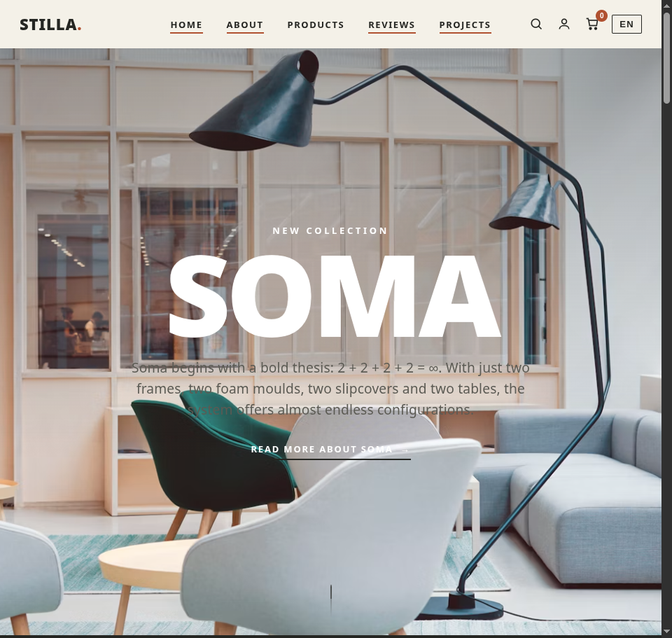
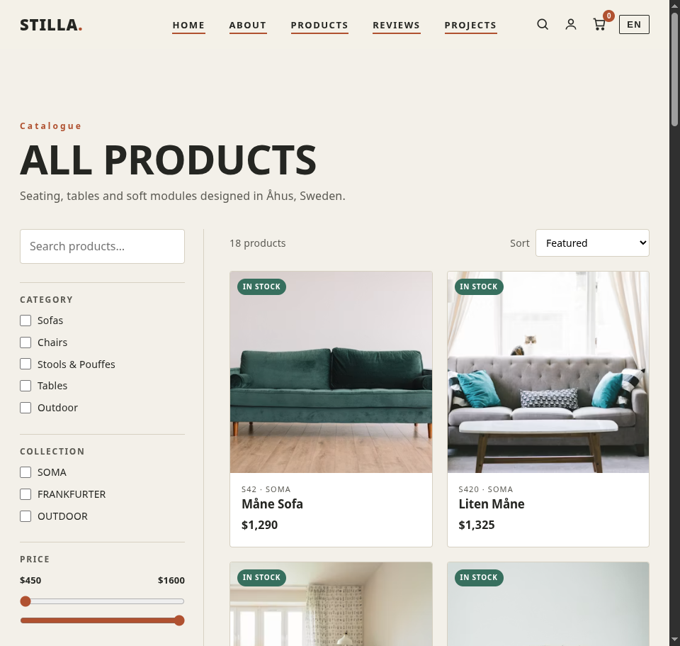
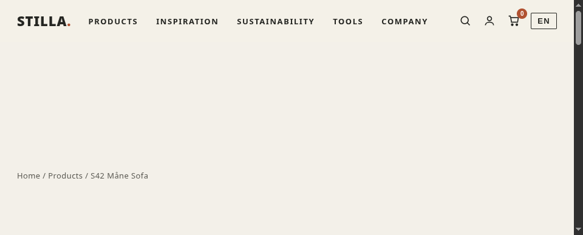
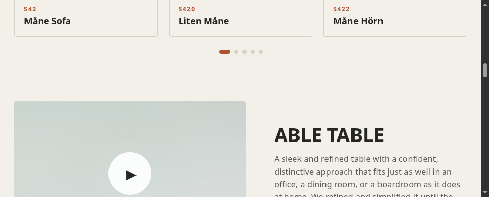
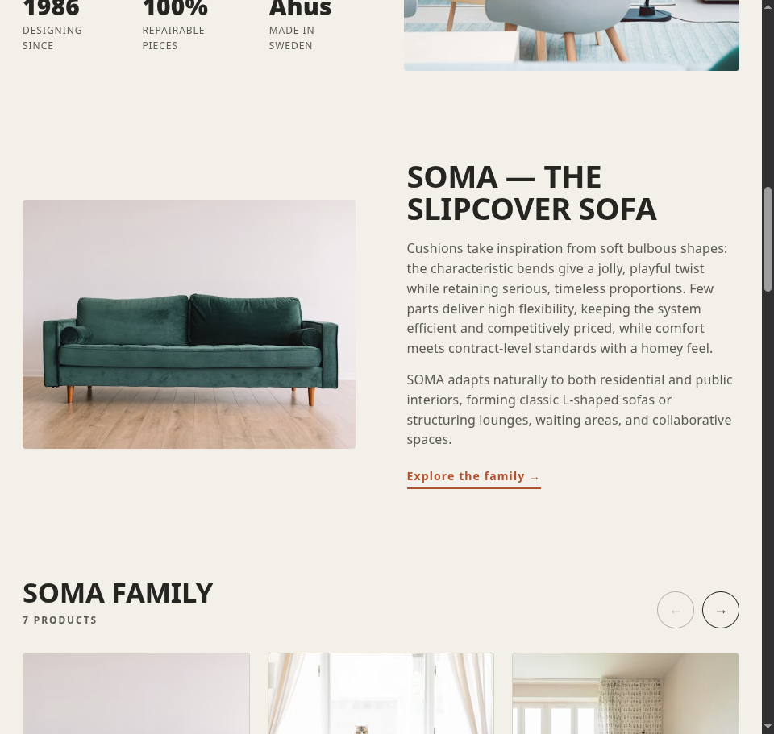
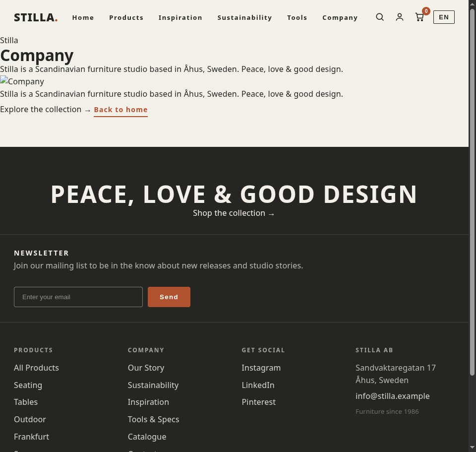
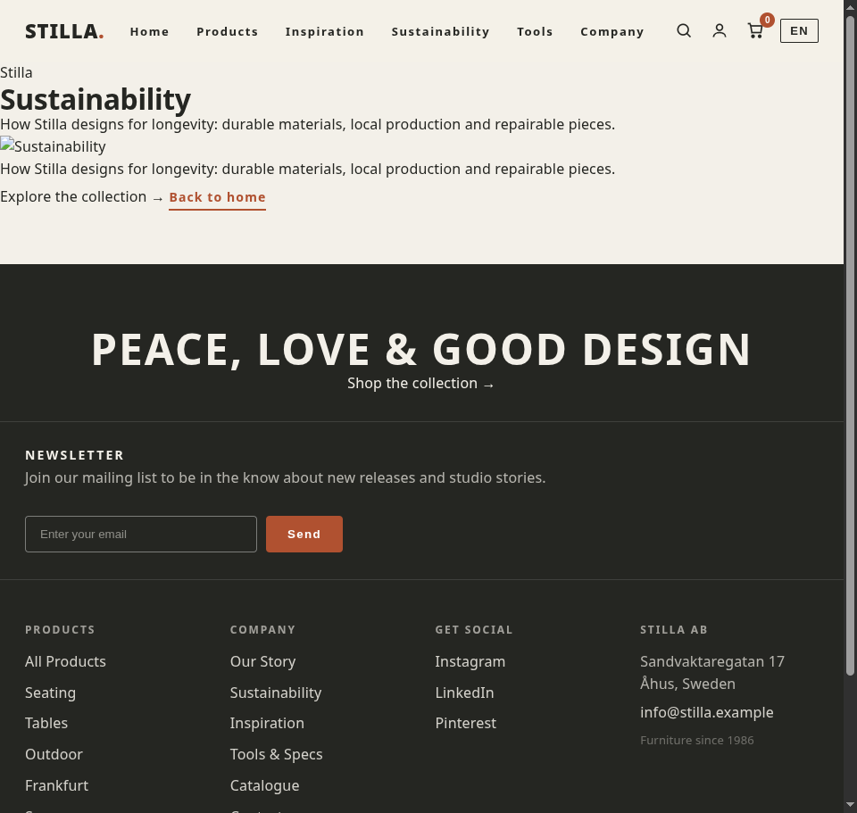
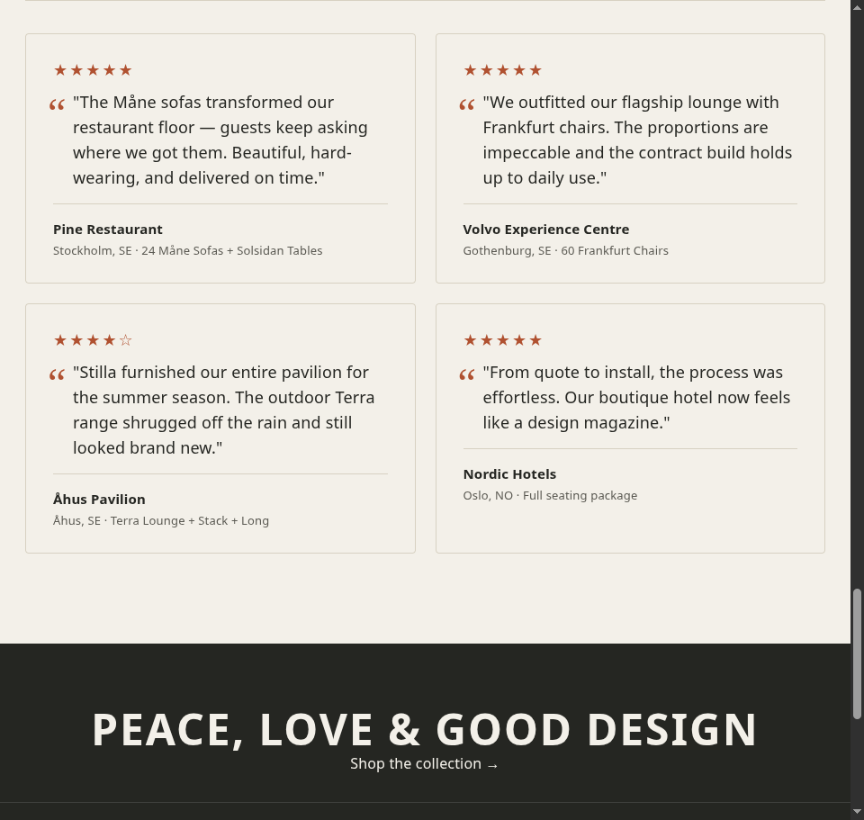
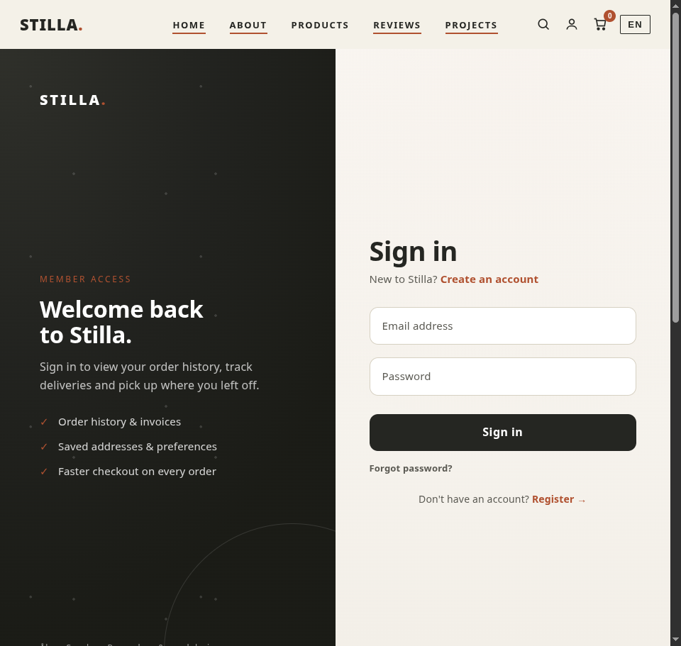
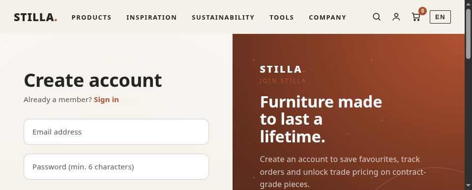

# Stilla — Scandinavian Furniture Storefront (WordPress)

A self-contained WordPress + Docker furniture storefront with a custom **Stilla** theme that
recreates and *improves* the editorial, design-led feel of https://blastation.com — sticky
nav, parallax hero, draggable product carousels, scroll-reveal, a startech-style catalogue,
individual product pages, a shopping cart, customer accounts, Stripe checkout, and built-in
SEO.

> Fictional brand "Stilla" with products (Måne Sofa, Frankfurt Chair, Terra Lounge, …) as
> stand-ins for Blå Station's real line. Swap copy/imagery for your own.

## Screenshots

| Home | Catalogue | Product page |
|------|-----------|--------------|
|  |  |  |

| Client reviews | Film / video section | Content page (Company) |
|----------------|----------------------|------------------------|
|  |  |  |

| Inspiration | Sustainability | Footer |
|-------------|----------------|--------|
|  |  |  |

| Sign in | Create account |
|---------|----------------|
|  |  |

## Features

- **Editorial homepage** — parallax hero, animated marquee, draggable product carousels
  (SOMA / FRANKFURTER families) with prev-next + dots, tilt-on-hover editorials, an **About**
  section, a **film section** (responsive `<video>` with poster), client reviews, and a
  newsletter footer. Respects `prefers-reduced-motion`.
- **Navbar** — logo left, centered primary links (**Home / About / Products / Reviews /
  Projects**) that scroll to on-page sections, and right-aligned search / account / cart /
  language controls. Fully responsive with a slide-in mobile menu.
- **Self-hosted showreel** — the film section reads its MP4 from the Customizer
  (*Appearance → Customize → Film / Showreel*). A bundled clip is imported into the Media
  Library and selected by default; upload your own furniture film and set its URL there — no
  code change needed.
- **Content pages** — footer-linked editorial pages **Inspiration**, **Sustainability**,
  **Tools** and **Company**, each with a branded hero, featured image and SEO metadata.
- **Product detail pages** (`/product/<slug>/`) — minimal layout with sticky gallery +
  thumbnail switcher, price (incl. VAT), stock badge, quantity stepper, Add to cart / Buy now
  / Request a quote, and Specifications / Delivery & care accordions.
- **Shopping cart** — session-based, slide-in drawer with live count badge, plus a dedicated
  `/cart/` page with quantity steppers and remove.
- **Customer accounts** — separate, professionally designed **Sign in** (`/login/`) and
  **Create account** (`/register/`) pages with a split-screen brand panel + form, floating
  labels, and a "Forgot password?" reset flow. Logged-in users get a **My Account**
  dashboard with order history.
- **Stripe payments** — single-product "Buy now" and multi-item cart checkout both create
  Stripe Checkout Sessions and redirect to hosted checkout. Orders are recorded against the
  user on return. *(Test card: 4242 4242 4242 4242.)*
- **Quote requests** — every product has a "Request a quote" modal saved as a private
  inquiry post in WP admin.
- **Client stories & reviews** — a "Trusted by Studios & Brands" section with client logos
  and four customer reviews (with star ratings) framed as delivered projects.
- **SEO built in** — per-page `<title>` + meta description, canonical URL, Open Graph +
  Twitter cards, JSON-LD structured data (Organization, Product + Offer, BreadcrumbList),
  an XML `sitemap.xml`, and a `robots.txt` that points crawlers at the sitemap.
- **Real photography** — product/editorial imagery pulled from Unsplash via `stilla_img()`.

## Stack

- WordPress 6.x (PHP 8.3-FPM) in Docker
- MariaDB 11.4
- nginx on port **8080**
- Custom theme: `themes/stilla`

## Run

```bash
cd /home/rownak/projects/blastation-style
docker compose up -d
# open http://localhost:8080
```

## Stop

```bash
docker compose down        # keep the database
docker compose down -v     # wipe the database
```

## Admin

- URL:  http://localhost:8080/wp-admin
- User: `admin`
- Pass: `Admin@12345!`  *(change it!)*
- Change: WP admin → Users, or
  ```bash
  docker compose exec -T wordpress wp user update admin --user_pass='NEW' --allow-root
  ```

## Configure Stripe (test mode is pre-wired)

The storefront uses **Stripe Checkout** (server-side session, test mode). The publishable key
is already set in `themes/stilla/functions.php`. The **secret key is injected via the
`STILLA_STRIPE_SK` environment variable** (see `.env` + `docker-compose.yml`) so it never
lands in version control.

To run a full test checkout:

1. Put your test secret key in `.env`:
   ```bash
   STILLA_STRIPE_SK=sk_test_xxx
   ```
2. Restart the stack so the container picks it up:
   ```bash
   docker compose up -d
   ```
3. Sign in, click **Buy now**, and pay with test card `4242 4242 4242 4242` (any future date,
   any CVC). You'll be redirected to the order-success page.

For **live payments**, replace both keys with live keys and point `STILLA_STRIPE_API` at
`https://api.stripe.com` (the publishable key is safe to commit; keep the secret in `.env`).

## Public URL (Cloudflare quick tunnel)

The site runs locally on port 8080. To share it:

```bash
cloudflared tunnel --url http://localhost:8080
```

It prints a `https://*.trycloudflare.com` URL. A mu-plugin
(`wp-content/mu-plugins/dynamic-url.php`) makes WordPress URLs follow the incoming Host, so
assets and the cart work behind any tunnel without hardcoding URLs. *Quick-tunnel URLs rotate
on restart — for a stable URL use a named Cloudflare tunnel or a domain.*

## SEO endpoints

- `https://<site>/sitemap.xml` — XML sitemap (home, catalogue, every product).
- `https://<site>/robots.txt` — allows indexing, disallows auth/cart/account, links the sitemap.

## Project structure

```
themes/stilla/
├── front-page.php          # hero, marquee, SOMA/FRANKFURTER carousels, showreel,
│                            #   editorials, "Trusted by Studios & Brands" reviews
├── header.php / footer.php  # sticky nav + search drawer + cart drawer / newsletter footer
├── archive-products.php     # /products — startech-style grid + sidebar filters
├── single-product.php       # /product/<slug>/ — gallery, specs, related, quote modal
├── login.php / register.php # split-screen auth pages
├── account.php              # logged-in dashboard (order history)
├── cart.php                 # /cart/ — line items + checkout
├── functions.php            # image helper, product data, routing, auth, cart,
│                            #   Stripe, quote AJAX, SEO (meta/OG/sitemap/robots)
└── assets/
    ├── css/main.css         # all styling
    └── js/main.js           # carousel, parallax, reveal, nav, tilt, filters,
                             #   cart, quote modal, star ratings, forgot-password
docs/                        # README screenshots
```

## Editing notes

- Theme files are bind-mounted: edit on disk → refresh, no rebuild needed.
- Products are the single source of truth in `stilla_products()` (functions.php):
  `slug, code, name, family, type, image key, price, stock, blurb, specs[], gallery[]`.
- After changing product data or routes, flush rewrites
  (`docker compose exec -T wordpress wp rewrite flush --hard --allow-root`).
- Imagery is curated Unsplash IDs in `stilla_images()`; swap an ID or use
  `wp_get_attachment_image_url()` for your own uploads.

## Fictional brand note

"Stilla" and its products (Måne, Frankfurt, Terra, …) are fictional placeholders for Blå
Station's real catalogue. Replace all copy and imagery with your own before going live.
